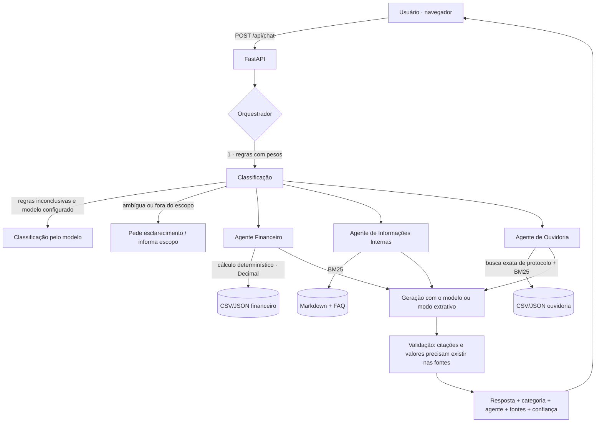

# Assistente Aurora — agente orquestrador multidomínio

Aplicação web de IA que recebe perguntas em linguagem natural, identifica o domínio de cada uma
e encaminha para o agente especializado adequado: **Financeiro**, **Informações Internas** ou
**Ouvidoria**. As respostas são fundamentadas **somente** nas bases de conhecimento fornecidas
e sempre mostram o domínio usado e as fontes consultadas.

> **Protótipo técnico.** Todas as bases são sintéticas e descrevem uma empresa fictícia
> (Aurora Serviços Digitais S.A.). O projeto não alega conformidade regulatória nem segurança
> de produção.

## Sumário

- [Status da entrega](#status-da-entrega)
- [Problema que resolve](#problema-que-resolve)
- [Arquitetura e fluxo](#arquitetura-e-fluxo)
- [Tecnologias](#tecnologias)
- [Estrutura de pastas](#estrutura-de-pastas)
- [Execução com Docker](#execução-com-docker)
- [Execução local sem Docker](#execução-local-sem-docker)
- [Variáveis de ambiente e provedor de IA](#variáveis-de-ambiente-e-provedor-de-ia)
- [Bases de conhecimento](#bases-de-conhecimento)
- [Endpoints](#endpoints)
- [Como interpretar as respostas e as fontes](#como-interpretar-as-respostas-e-as-fontes)
- [Testes e avaliação](#testes-e-avaliação)
- [Segurança](#segurança)
- [Limitações conhecidas](#limitações-conhecidas)
- [Desenvolvimento assistido por IA](#desenvolvimento-assistido-por-ia)
- [Publicação no GitHub](#publicação-no-github)

## Status da entrega

| # | Item pedido | Onde está | Situação |
|---|---|---|---|
| 1 | Repositório GitHub | https://github.com/henriquepella/areco | Código completo na branch `main`, cada etapa em seu próprio branch |
| 2 | Execução via Docker | `backend/Dockerfile`, `docker-compose.yml`, `.env.example`, [instruções](#execução-com-docker) | Arquivos prontos. O passo a passo do README é executado pelo workflow de CI a cada push (aba *Actions*) |
| 3 | Frontend | `frontend/` (HTML, CSS e JS puro) | Funcionando; testado em desktop e celular |
| 4 | Orquestrador e agentes | `backend/app/agents/` | Funcionando; roteamento 32/32 na avaliação |
| 5 | Uso das bases de conhecimento | `backend/app/knowledge_base/`, `services/document_service.py`, `services/retrieval_service.py` | Carregadas e indexadas automaticamente na inicialização |
| 6 | Logs das interações com o agente | [`docs/logs/interacoes_exemplo.jsonl`](docs/logs/interacoes_exemplo.jsonl) (exemplo real) e volume `interaction_logs` em execução | Gravados pela API em JSON Lines |
| 7 | `AGENTS.md` com registro do processo | [`AGENTS.md`](AGENTS.md) + [`docs/AI_DEVELOPMENT_LOG.md`](docs/AI_DEVELOPMENT_LOG.md) | Atualizado a cada etapa |
| 8 | Histórico das conversas com IA | [`docs/ai_conversations/`](docs/ai_conversations/) | Exportação original do Claude Code, anonimizada, + registro manual |
| 9 | Documentação | Este README | Arquitetura, decisões, limitações e testes |

### O que está funcionando

- Orquestrador híbrido (regras com pesos + modelo opcional) com três agentes especializados.
- Respostas apenas a partir das bases, com fontes; reconhece quando não há evidência, pede
  esclarecimento em perguntas ambíguas e recusa pedidos de credenciais ou dados pessoais.
- Valores financeiros calculados de forma determinística e conferidos contra os CSVs.
- Interface web integrada à API, com encaminhamento visível e animação de digitação.
- 102 testes automatizados e avaliação com métricas separadas, sem chamadas pagas.
- Registro das interações com mascaramento de dados pessoais.

### O que ficou pendente ou sem verificação

- **Modo com modelo de linguagem:** implementado para Anthropic e APIs compatíveis com OpenAI,
  mas **não foi exercitado contra um provedor real** (não havia chave de API durante o
  desenvolvimento). As barreiras contra respostas infiéis foram testadas com um modelo simulado.
- **Docker:** não foi executado na máquina de desenvolvimento, que não tem Docker instalado. A
  validação fica a cargo do workflow [`.github/workflows/ci.yml`](.github/workflows/ci.yml), que
  segue o README num runner Linux do GitHub: `docker compose up --build`, healthcheck, `/health`,
  frontend, `/api/chat` com valor conferido, 38 perguntas contra o container, volume de logs e
  `pytest` dentro do container. O resultado fica na aba *Actions*. Docker Desktop no Windows e no
  macOS não foi testado.
- Itens fora do escopo desta versão: memória de conversa, autenticação, rate limiting, registro
  real de manifestações (não existe sistema transacional nos anexos) e PDF/DOCX (nenhum anexo
  nesses formatos). Detalhes em [Limitações conhecidas](#limitações-conhecidas).

### Dificuldades e alternativas tentadas

| Problema | O que foi tentado | Solução adotada |
|---|---|---|
| Sem Docker na máquina de desenvolvimento | Validar o app com as mesmas variáveis e o mesmo diretório da imagem | Workflow do GitHub Actions que segue o README: `docker compose up --build`, healthcheck, chamadas à API e testes dentro do container |
| Busca devolvia trechos sem relação ("horário do refeitório" → incidentes) | Cobertura simples de termos com corte de 0,3 | Cobertura ponderada por IDF; verbos genéricos como stopwords |
| Perguntas divididas entre domínios ("gasto e política") | Só um limiar de confiança | Confiança mínima **e** margem mínima entre o 1º e o 2º domínio |
| Digitação não aparecia nesta máquina | Desligar a animação com "reduzir movimento" | Manter a escrita progressiva (não move nada na tela) e trocar só os deslocamentos por esmaecimento |
| Resposta em branco com a janela oculta | `requestAnimationFrame` | `setTimeout` com progresso pelo tempo real |
| Log apagava e-mails oficiais da base | Mascarar pergunta e resposta | Mascarar só a pergunta (texto livre do usuário) |

O registro completo, com comandos e resultados, está no [diário](docs/AI_DEVELOPMENT_LOG.md).

### Decisões técnicas principais

- **CSV em memória em vez de PostgreSQL.** O pacote sugeria carregar os CSVs em PostgreSQL
  (`docs/fonte_pacote/sql/schema.sql`). Com 300 lançamentos e 180 manifestações, os dados são
  lidos em memória e os cálculos usam `Decimal`, a mesma precisão de `NUMERIC(14,2)`. Assim a
  aplicação fica num único container, sem banco para provisionar. As consultas são funções Python
  com filtros fixos, e nunca SQL gerado pelo modelo, como o próprio pacote recomenda. Com bases
  maiores, o caminho é importar para PostgreSQL usando o schema fornecido.
- **BM25 em vez de embeddings:** proporcional a cerca de 650 trechos curtos, sem dependências nem
  custo, e explicável pela pontuação.
- **Classificação híbrida:** regras explicáveis e testáveis sem API; o modelo só desempata.
- **Funciona sem chave de API:** respostas determinísticas ou extrativas, sem simular um modelo.

### O que eu faria diferente

- Configuraria o CI com Docker no primeiro dia, em vez de descobrir no fim que não havia Docker local.
- Conseguiria cedo uma chave de API de teste, para medir o modo com modelo e as barreiras de
  fidelidade com respostas reais.
- Montaria o conjunto de avaliação antes de ajustar pesos, separando casos de ajuste e de teste,
  para evitar o risco de sobreajuste registrado no diário.
- Definiria o fluxo de conversa da interface (fases, digitação) junto com o primeiro layout, em
  vez de redesenhar depois.
- Usaria um stemmer pronto para português (RSLP) em vez do stemmer mínimo.

### Como concluir e melhorar

1. Rodar a avaliação com `LLM_PROVIDER=anthropic` e comparar com o modo sem modelo.
2. Adicionar memória curta de conversa para responder a pedidos de esclarecimento.
3. Autenticação e rate limiting antes de qualquer exposição pública.
4. Integração autorizada com um sistema de ouvidoria para registrar manifestações.
5. Ampliar o conjunto de avaliação e incluir um juiz semântico para fidelidade.

## Problema que resolve

Em uma empresa, as dúvidas dos colaboradores se espalham por fontes diferentes: planilhas
financeiras, políticas internas e registros de ouvidoria. Um chatbot genérico mistura essas
fontes e pode inventar números, regras ou protocolos. Aqui, um **orquestrador** decide qual
especialista atende cada pergunta. Cada especialista consulta **apenas** a base do seu domínio
e responde com evidências, ou diz claramente que não encontrou informação suficiente.

## Arquitetura e fluxo



Passo a passo de uma pergunta:

1. O frontend envia a pergunta para `POST /api/chat`.
2. O backend valida a entrada (vazia, tamanho máximo, JSON malformado).
3. O **orquestrador** classifica a pergunta como `financeiro`, `informacoes_internas`,
   `ouvidoria` ou `indefinido` (ver [decisão técnica](#decisão-técnica-do-orquestrador)).
4. O agente do domínio consulta **somente o índice do seu domínio**.
5. A resposta é montada a partir do que foi recuperado ou calculado.
6. O resultado volta com categoria, agente, modo de resposta, status, fontes e confiança.

### Os agentes

| Agente | Base | Como responde |
|---|---|---|
| **Financeiro** | `lancamentos_financeiros.csv`, `orcamento_mensal.csv`, `indicadores_e_regras.json` | Somas, contagens, rankings, orçamento, execução orçamentária e inadimplência **calculados em Python com `Decimal`**, seguindo as regras do JSON (competência, não vencimento; "pagas" = status Pago). O critério do filtro é sempre exibido. Perguntas conceituais ("o que é…") usam RAG sobre o JSON de indicadores. O modelo nunca estima valores. |
| **Informações Internas** | 10 políticas em Markdown + `faq_interno.json` | RAG com BM25. Diferencia documentado de não encontrado. Pedidos de senhas, credenciais ou dados de terceiros são recusados com base nas políticas de segurança e privacidade. |
| **Ouvidoria** | `manifestacoes.csv`, `referencia_ouvidoria.json` | Busca **exata** de protocolo (`OUV-NNNN`); listas oficiais de status, prioridades e categorias; contagens com filtros. **Não registra** manifestações: não há sistema transacional nos anexos, e o agente diz isso explicitamente. Nunca identifica manifestantes. |

### Decisão técnica do orquestrador

Abordagem **híbrida**:

1. **Regras determinísticas** com pesos por domínio (`backend/app/agents/orchestrator.py`).
   Rápidas, explicáveis (a resposta traz os termos que pontuaram) e testáveis sem chamar API.
2. **Modelo de linguagem**, apenas quando as regras ficam inconclusivas **e** existe provedor
   configurado. A saída é restrita às categorias válidas; qualquer outra coisa vira `indefinido`.
3. Sem modelo: pergunta ambígua → pedido de esclarecimento; sem nenhum termo de domínio → fora do escopo.

**Métrica de confiança** (método "rules"):
`pontos_do_vencedor / soma_dos_pontos × min(1, pontos_do_vencedor / 4)`. Exige confiança ≥ 0,4
**e** margem ≥ 1,5 ponto sobre o 2º domínio. Quando a classificação vem do modelo, `confidence`
é `null`: não há estimativa calibrada, e o projeto não inventa uma.

A classificação pode ser testada isoladamente em `POST /api/classify`.

### Recuperação (RAG)

- **BM25** em Python puro, com **um índice por domínio**. A base tem cerca de 650 trechos curtos,
  então não há banco vetorial nem dependência de embeddings.
- Normalização para português: minúsculas, remoção de acentos, stopwords e um stemmer de sufixos mínimo.
- **Divisão em trechos:** Markdown por seção `##` (o cabeçalho com a versão vai junto da 1ª seção),
  JSON por item ou chave, CSV uma linha por trecho.
- **Metadados:** arquivo, domínio, seção, versão do documento; `page` é sempre `null` (não há PDF).
- **Evidência suficiente:** BM25 ≥ 1,5 **e** cobertura dos termos da pergunta ponderada por IDF ≥ 0,3.
  Abaixo disso, o agente responde que não encontrou informação.
- O índice é reconstruído em memória ao iniciar, em milissegundos. Por isso ele não é persistido.

## Tecnologias

- **Backend:** Python 3.12, FastAPI, Pydantic v2, Uvicorn, httpx.
- **IA:** SDK oficial `anthropic` (Claude) ou qualquer API compatível com OpenAI `/chat/completions`
  (OpenAI, Ollama, OpenRouter...). Também funciona sem modelo.
- **Busca:** BM25 próprio (sem dependências).
- **Frontend:** HTML, CSS e JavaScript puro (sem frameworks), servido pelo próprio FastAPI.
- **Testes:** pytest + `fastapi.testclient`.
- **Infra:** Docker e Docker Compose.

## Estrutura de pastas

```
.
├── AGENTS.md                     # regras para agentes de IA e registro do desenvolvimento
├── docker-compose.yml
├── .env.example
├── backend/
│   ├── Dockerfile
│   ├── requirements.txt
│   ├── pytest.ini
│   ├── app/
│   │   ├── main.py               # app FastAPI, handlers de erro, headers, frontend estático
│   │   ├── api/routes/           # chat.py (chat, classify, agents, knowledge) e health.py
│   │   ├── agents/               # orchestrator, base, financial, internal_info, ombudsman
│   │   ├── services/             # document_service, retrieval_service (BM25), llm_service
│   │   ├── models/schemas.py     # contratos Pydantic
│   │   ├── core/                 # config (env) e logs JSON
│   │   └── knowledge_base/       # bases fornecidas, uma pasta por domínio
│   └── tests/                    # testes pytest + eval/ (avaliação)
├── frontend/                     # index.html, css/styles.css, js/app.js
└── docs/
    ├── AI_DEVELOPMENT_LOG.md     # diário de desenvolvimento com IA
    ├── ai_conversations/         # registros das conversas com IA
    ├── logs/                     # exemplo real do registro de interações com o agente
    └── fonte_pacote/             # documentação e SQL que vieram no pacote (não indexados)
```

## Execução com Docker

Pré-requisitos: [Docker](https://docs.docker.com/get-docker/) com Docker Compose v2.24+.

```bash
git clone https://github.com/henriquepella/areco.git
cd areco
cp .env.example .env
docker compose up --build
```

No **Windows**, troque o `cp` por:

```powershell
Copy-Item .env.example .env
```

(no Prompt de Comando: `copy .env.example .env`)

Acesse **http://localhost:8000**. A documentação interativa da API fica em **http://localhost:8000/docs**.

| Ação | Comando |
|---|---|
| Subir em segundo plano | `docker compose up -d --build` |
| Ver logs | `docker compose logs -f app` |
| Estado e healthcheck | `docker compose ps` |
| Parar | `docker compose down` |
| Reconstruir do zero | `docker compose build --no-cache && docker compose up -d` |
| Reindexar após editar documentos | `docker compose restart app` |
| Rodar os testes no container | `docker compose run --rm app python -m pytest` |

Sem `.env`, ou com `LLM_PROVIDER=none`, a aplicação sobe em **modo extrativo** (ver abaixo).
Para usar outra porta, defina `APP_PORT` no `.env`.

> Nota: o Docker não estava instalado na máquina de desenvolvimento, então o passo a passo
> acima é validado pelo workflow [`.github/workflows/ci.yml`](.github/workflows/ci.yml) em um
> runner Linux do GitHub a cada push (resultado na aba *Actions*).

## Execução local sem Docker

Requer Python 3.12+.

```bash
python -m venv .venv
source .venv/bin/activate          # Windows: .venv\Scripts\activate
pip install -r backend/requirements.txt
cd backend
uvicorn app.main:app --reload --port 8000
```

As variáveis podem ser exportadas no shell. Fora do Docker, o `.env` **não** é lido
automaticamente. Exemplo no PowerShell: `$env:LLM_PROVIDER="anthropic"; $env:LLM_API_KEY="..."`.

## Variáveis de ambiente e provedor de IA

| Variável | Padrão | Descrição |
|---|---|---|
| `LLM_PROVIDER` | `none` | `none`, `anthropic` ou `openai` (qualquer API compatível). |
| `LLM_MODEL` | `claude-opus-5-5` para `anthropic` | Obrigatório para `openai`. |
| `LLM_API_KEY` | vazio | Chave do provedor. Fica só no backend, nunca vai ao navegador. |
| `LLM_BASE_URL` | vazio | URL alternativa (ex.: Ollama `http://localhost:11434/v1`). |
| `LLM_TIMEOUT_SECONDS` | `30` | Tempo limite por chamada ao provedor. |
| `APP_PORT` | `8000` | Porta publicada pelo Docker Compose. |
| `MAX_QUESTION_CHARS` | `1000` | Tamanho máximo da pergunta. |
| `RETRIEVAL_TOP_K` | `4` | Trechos usados como contexto. |
| `LOG_LEVEL` | `INFO` | Nível de log. |
| `KNOWLEDGE_DIR`, `FRONTEND_DIR` | pastas do projeto | Já definidos na imagem Docker. |

Exemplos de `.env`:

```dotenv
# Claude (Anthropic)
LLM_PROVIDER=anthropic
LLM_API_KEY=<sua-chave>
LLM_MODEL=claude-opus-5-5

# Ollama rodando no host, acessado pelo container
LLM_PROVIDER=openai
LLM_BASE_URL=http://host.docker.internal:11434/v1
LLM_MODEL=<modelo-instalado-no-ollama>
```

> No Linux, `host.docker.internal` exige adicionar `extra_hosts: ["host.docker.internal:host-gateway"]`
> ao serviço no `docker-compose.yml`.

**Trocar de provedor** não exige mexer na lógica de negócio. Os agentes só chamam
`LLMService.complete(system, user)` em `backend/app/services/llm_service.py`. Para um novo
provedor, basta acrescentar um método nesse arquivo.

**Modo extrativo (sem chave).** A aplicação funciona sem modelo de linguagem e informa isso no
cabeçalho ("Online, sem modelo de IA", com o motivo ao passar o mouse), em `GET /health` e no
modo de cada resposta (`"mode": "extractive"`, exibido como "Trechos dos documentos, sem modelo
de IA"):

- Financeiro e ouvidoria: respostas determinísticas, completas, calculadas sobre os dados.
- Informações internas: devolve a resposta da FAQ quando houver e os trechos mais relevantes,
  identificados por arquivo e seção. Nada é simulado como se viesse de um modelo.

Se o provedor configurado falhar (rede, autenticação, recusa) ou a resposta do modelo for
descartada por infidelidade às fontes, a resposta cai automaticamente para o modo extrativo e o
campo `notice` explica o motivo. O `notice` fica reservado a esses avisos excepcionais.

## Bases de conhecimento

Ficam em `backend/app/knowledge_base/<domínio>/`. **A pasta define o domínio:**

```
knowledge_base/
├── financeiro/              → Agente Financeiro
├── informacoes_internas/    → Agente de Informações Internas
└── ouvidoria/               → Agente de Ouvidoria
```

- **Formatos aceitos:** `.md`, `.txt`, `.csv`, `.json` (UTF-8, até 5 MB). PDF e DOCX não foram
  implementados porque nenhum anexo usa esses formatos.
- Arquivos fora dessas pastas (ex.: `manifesto_pacote.json`) **não** são indexados e aparecem
  como ignorados em `/api/knowledge/status`.
- Arquivos vazios, com extensão não permitida, fora de UTF-8 ou malformados são rejeitados e
  listados com o motivo, sem derrubar a aplicação.
- **Adicionar ou atualizar:** coloque o arquivo na pasta do domínio e reinicie
  (`docker compose restart app`, ou reinicie o uvicorn). No Docker, a pasta é montada como
  volume somente leitura, então não é preciso reconstruir a imagem.
- O Agente Financeiro e o de Ouvidoria dependem dos nomes e colunas dos CSVs fornecidos
  (ver `docs/fonte_pacote/documentacao/dicionario_de_dados.md`). Novos Markdown/JSON entram
  na busca automaticamente.

## Endpoints

| Método | Rota | Descrição |
|---|---|---|
| `GET` | `/health` | Saúde do serviço, estado do índice e do provedor de IA (sem segredos). |
| `POST` | `/api/chat` | Pergunta → resposta, categoria, agente, fontes, confiança. |
| `POST` | `/api/classify` | Só a classificação do orquestrador (sem gerar resposta). |
| `GET` | `/api/agents` | Agentes disponíveis, funções e arquivos de cada um. |
| `GET` | `/api/knowledge/status` | Indexação: arquivos e trechos por domínio, rejeitados e ignorados. |

Exemplo:

```bash
curl -X POST http://localhost:8000/api/chat \
  -H "Content-Type: application/json" \
  -d '{"question": "Quanto foi gasto em despesas pagas de janeiro a março de 2025?"}'
```

```json
{
  "question": "Quanto foi gasto em despesas pagas de janeiro a março de 2025?",
  "category": "financeiro",
  "agent": "Agente Financeiro",
  "answer": "Despesas com status Pago de 01/01/2025 a 31/03/2025: **R$ 305.937,01** (27 lançamentos).\nCritério: soma de valor_brl em decimal com tipo=Despesa; status=Pago; data_competencia de 2025-01-01 a 2025-03-31.",
  "status": "answered",
  "sources": [
    {
      "document": "lancamentos_financeiros.csv",
      "domain": "financeiro",
      "section": "consulta determinística",
      "page": null,
      "excerpt": "Filtro: tipo=Despesa; status=Pago; data_competencia de 2025-01-01 a 2025-03-31. 27 registro(s): FIN-0001, FIN-0002, ...",
      "score": null
    }
  ],
  "confidence": 1.0,
  "mode": "deterministic",
  "routing": {
    "method": "rules",
    "scores": {"financeiro": 8.5, "informacoes_internas": 0.0, "ouvidoria": 0.0},
    "matched_terms": {"financeiro": ["despesa", "gasto", "quanto", "pagas", "2025"], "informacoes_internas": [], "ouvidoria": []},
    "reason": "termos do domínio financeiro predominam"
  },
  "notice": null
}
```

*(Saída real, encurtada: a lista de IDs foi abreviada e a 2ª fonte, a regra de cálculo de
`indicadores_e_regras.json`, foi omitida.)*

Erros: `422` para entrada inválida ou longa demais, `500` com mensagem genérica (sem detalhes internos).

## Logs das interações

Cada pergunta respondida por `POST /api/chat` vira uma linha em um arquivo **JSON Lines** com a
pergunta (dados pessoais mascarados), categoria, agente, método e pontos do roteamento,
confiança, status, modo, fontes, resposta e latência.

- **Exemplo real:** [`docs/logs/interacoes_exemplo.jsonl`](docs/logs/interacoes_exemplo.jsonl),
  com 38 interações gravadas pela API em execução. Formato e como reproduzir em
  [`docs/logs/README.md`](docs/logs/README.md).
- **No Docker:** volume `interaction_logs`. Para copiar:
  `docker compose cp app:/app/logs/interacoes.jsonl ./interacoes.jsonl`
- **Local:** `logs/interacoes.jsonl` na raiz do projeto.
- `INTERACTION_LOG_PATH` muda o caminho; vazio desliga.

Logs técnicos do servidor saem em JSON no console (`docker compose logs app`).

## Como interpretar as respostas e as fontes

A conversa reproduz o caminho da pergunta:

1. Enquanto a API responde, a **Aurora** (orquestradora) aparece "analisando sua pergunta".
2. Uma linha de **encaminhamento** mostra para qual agente a pergunta foi enviada, com a
   **confiança do roteamento** (métrica acima; é a confiança na escolha do domínio, não na
   resposta). Passe o mouse para ver o motivo da classificação.
3. O agente aparece "digitando" e a resposta é escrita aos poucos. Clique na resposta ou
   pressione **Esc** para vê-la inteira de uma vez.

Cada agente tem cor e avatar próprios (Financeiro em verde-azulado, Informações Internas em
índigo, Ouvidoria em ameixa; a Aurora em azul-marinho). Na resposta:

- **Status**, quando não é uma resposta comum: *Sem evidência suficiente*, *Precisa de mais
  detalhes*, *Pedido recusado*, *Fora do escopo*.
- **Modo** no rodapé: *Calculado diretamente nos dados da base* (determinístico), *Trechos dos
  documentos, sem modelo de IA* (extrativo) ou *Escrito por IA a partir das fontes*.
- **Fontes consultadas** (expansível): arquivo, seção e o trecho usado; a pontuação BM25 aparece
  ao passar o mouse no nome do arquivo. Nas consultas determinísticas, o trecho descreve o filtro
  aplicado e os IDs dos registros somados.

A digitação é só apresentação: a resposta completa já chegou da API antes de começar. Com
"reduzir movimento" ativo no sistema, os deslocamentos (pontos saltando, entrada deslizante)
viram esmaecimentos; a escrita progressiva continua, porque não move nada na tela.

As fontes vêm sempre da recuperação ou da consulta, nunca do texto do modelo. Se o modelo citar
um arquivo que não recebeu, ou escrever um valor monetário ausente das fontes, a resposta dele é
descartada e o sistema exibe o conteúdo recuperado.

## Testes e avaliação

```bash
cd backend
python -m pytest                       # 88 testes, sem rede e sem API paga
python -m tests.eval.run_eval          # relatório de avaliação
python -m tests.eval.run_eval --save   # também grava tests/eval/resultados_<data>.json
```

Os testes cobrem classificação por domínio, perguntas ambíguas e fora do escopo, encaminhamento
para cada agente, recuperação, respostas sem evidência, documentos vazios ou inválidos, falhas
do provedor de IA (com LLM simulado), validação dos endpoints, saúde e cabeçalhos de segurança.
Arquivos criados nos testes são fixtures sintéticas identificadas como tal.

A **avaliação** (`backend/tests/eval/`) mede separadamente:

| Métrica | O que verifica | Resultado (modo sem modelo) |
|---|---|---|
| Roteamento | categoria prevista = esperada | 32/32 |
| Recuperação | documento esperado entre as fontes | 23/23 |
| Fidelidade | termos obrigatórios presentes na resposta (proxy) | 27/27 |
| Abstenção | status correto quando não se deve responder | 10/10 |

Ela usa os 12 casos do pacote (`perguntas_avaliacao.json`) e 20 casos extras
(`casos_adicionais.json`) **escritos pelo desenvolvedor**. Ressalvas: o conjunto é pequeno, alguns
pesos foram ajustados a partir dele (risco de sobreajuste), e o modo com modelo de linguagem
não foi avaliado (não havia chave de API no desenvolvimento).

## Segurança

- Chaves só em variáveis de ambiente. `.env` está no `.gitignore` e no `.dockerignore`;
  `Settings` não exibe a chave em `repr`; `/health` não expõe segredos.
- Pergunta validada e limitada a 1000 caracteres; o frontend também limita.
- Documentos tratados como dados não confiáveis: só texto é extraído, com allowlist de extensões,
  limite de tamanho e bloqueio de links simbólicos que saiam da base.
- **Prompt injection:** trechos enviados ao modelo entre delimitadores `<fontes>` (removidos do
  conteúdo), e o prompt de sistema manda ignorar instruções contidas neles. Pedidos de
  senhas/chaves na própria pergunta são recusados antes de chegar ao modelo.
- Barreiras contra invenção: o modelo não decide as fontes; citações e valores são conferidos; o
  agente de ouvidoria nunca afirma registro, encaminhamento ou resolução.
- Logs técnicos do console sem o texto da pergunta e sem mensagens de erro do provedor. O
  registro de interações guarda a pergunta com e-mail, CPF, telefone, números longos e
  senhas/chaves mascarados, e erros apenas pelo tipo da exceção.
- Respostas de erro genéricas; CSP `self`, `nosniff`, `frame-ancestors 'none'`; container sem root.
- O frontend renderiza respostas via DOM (`textContent`), sem `innerHTML` com dados da API.

## Limitações conhecidas

- **Sem memória de conversa:** cada pergunta é independente. Para responder a um pedido de
  esclarecimento, reformule a pergunta completa.
- **Classificação por regras** depende de vocabulário. Sinônimos fora da lista caem em
  `indefinido` quando não há modelo configurado.
- **Parser financeiro** entende meses por extenso, anos, trimestres, semestres, departamentos,
  categorias, centros de custo e status. Expressões como "últimos 3 meses" ou "ano passado" não
  são interpretadas.
- **Registro de manifestações** não implementado: não existe sistema transacional nos anexos.
  Exigiria integração autorizada com o sistema de ouvidoria.
- **PDF/DOCX** não suportados (nenhum anexo nesses formatos).
- **Sem autenticação, autorização ou rate limiting.** Não é adequado para exposição pública.
- **Fidelidade** medida por palavras-chave; não há avaliação semântica com modelo juiz.
- Docker não foi executado na máquina de desenvolvimento; a validação é feita pelo CI (Linux).

Melhorias futuras: histórico de conversa, stemmer RSLP, embeddings como opção, avaliação com o
modelo ativo, autenticação, rate limiting e integração real com a ouvidoria.

## Desenvolvimento assistido por IA

O projeto foi desenvolvido com o **Claude Code** (modelo Claude Opus 5.5). O processo está documentado em:

- [`AGENTS.md`](AGENTS.md): regras para qualquer agente de IA que trabalhe no repositório,
  incluindo como manter o registro.
- [`docs/AI_DEVELOPMENT_LOG.md`](docs/AI_DEVELOPMENT_LOG.md): diário por etapa, com prompts
  resumidos, decisões (aceitas, modificadas, rejeitadas), problemas, correções e resultados reais
  dos testes.
- [`docs/ai_conversations/`](docs/ai_conversations/): a exportação original da sessão do Claude
  Code (anonimizada por [`scripts/anonimizar_conversa.py`](scripts/anonimizar_conversa.py), com a
  lista do que foi removido e por quê), uma versão legível em Markdown e o registro manual.

O histórico do Git segue o mesmo processo: cada parte foi feita num branch próprio
(`feat/rag-retrieval`, `feat/agents`, `feat/orchestrator`, `feat/api`, `feat/frontend`,
`feat/docker`, `feat/evaluation`, `feat/ui-refresh`, `feat/interaction-logs`,
`ci/docker-validation`, `docs/...`) e integrada à `main` com merge `--no-ff`. O workflow
[`.github/workflows/ci.yml`](.github/workflows/ci.yml) roda os testes e o passo a passo do Docker
a cada push.

## Publicação no GitHub

O remoto deste repositório é `https://github.com/henriquepella/areco`. Para publicar
alterações futuras:

```bash
git checkout -b <tipo>/<descricao>
git add <arquivos>
git commit -m "<tipo>(<escopo>): <descrição>"
git checkout main
git merge --no-ff <tipo>/<descricao>
git push origin main <tipo>/<descricao>
```

Antes de cada push, confira que nenhum `.env`, chave ou dado pessoal foi adicionado:
`git status` e `git diff --staged`.
